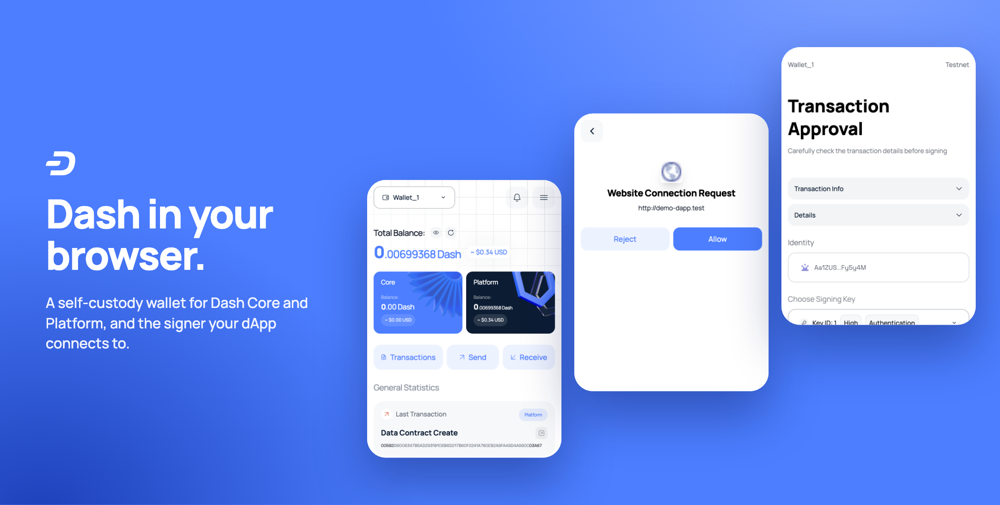
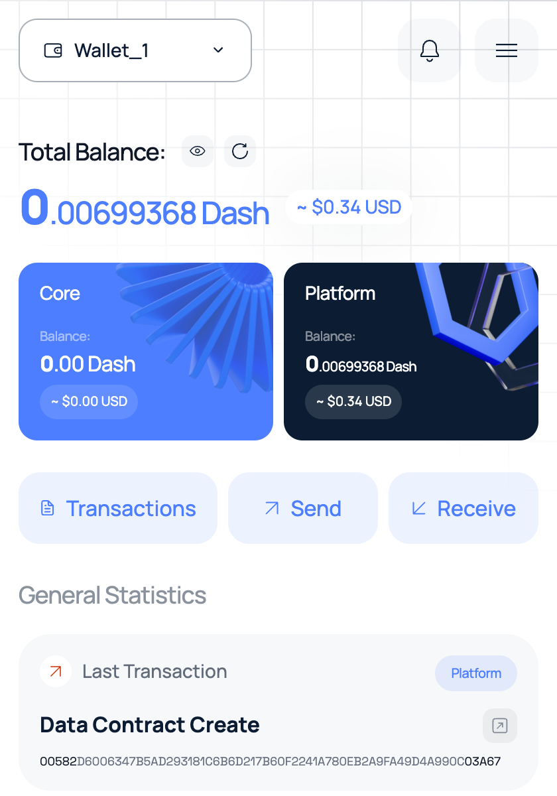
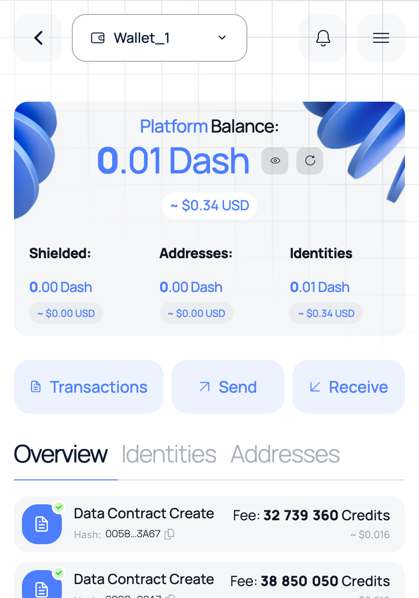
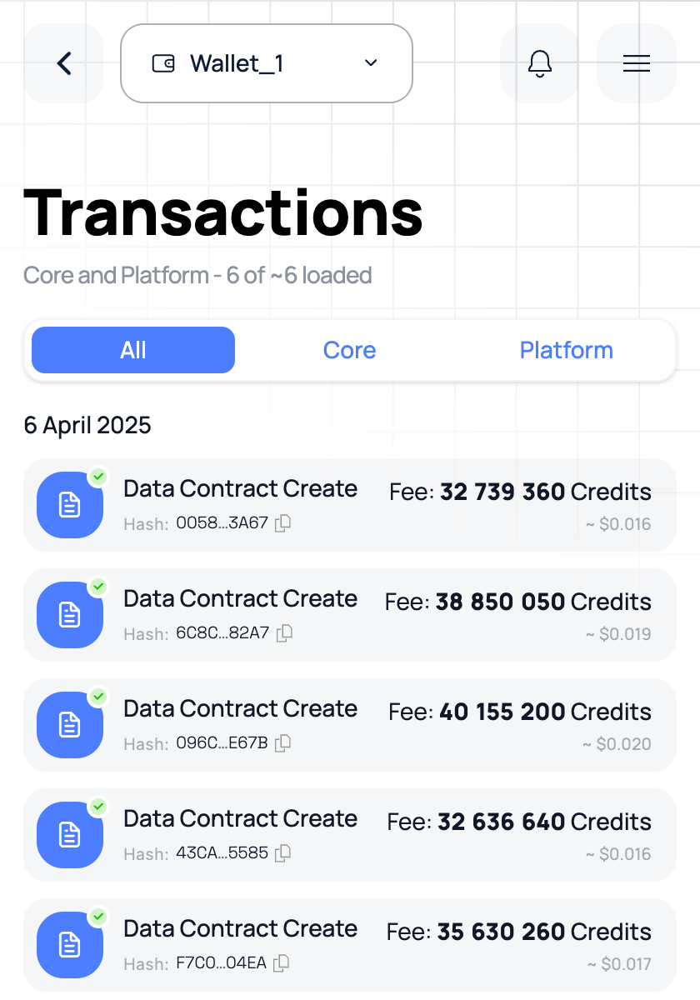
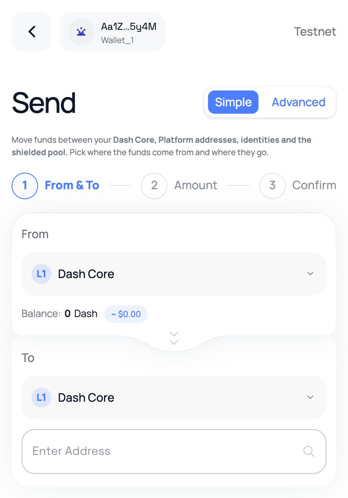
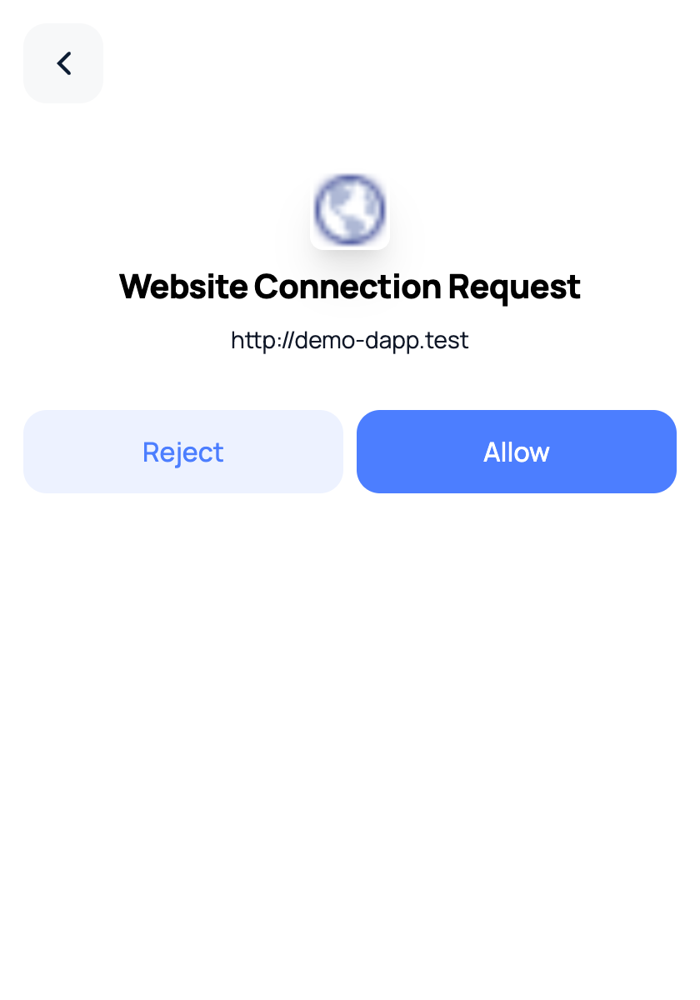
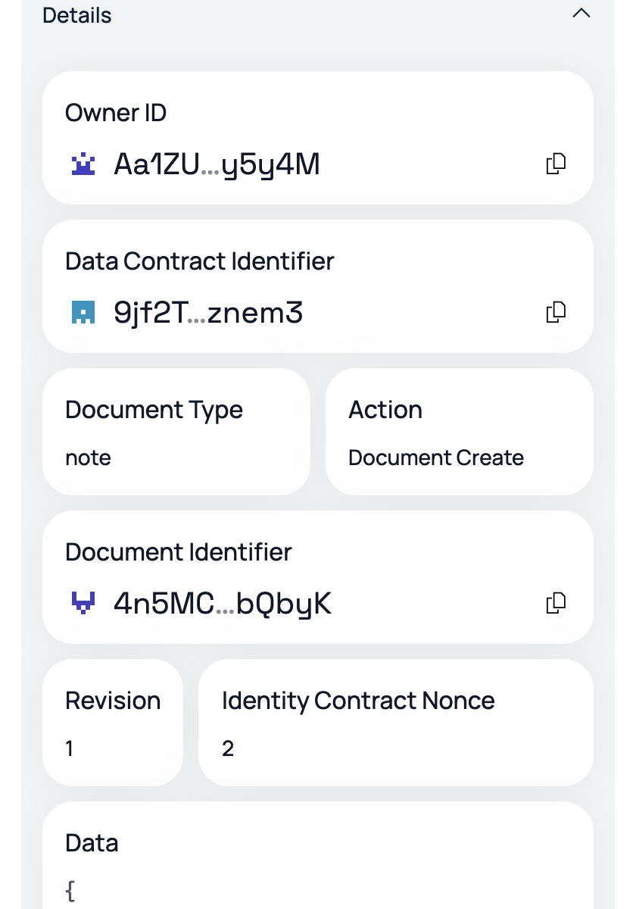
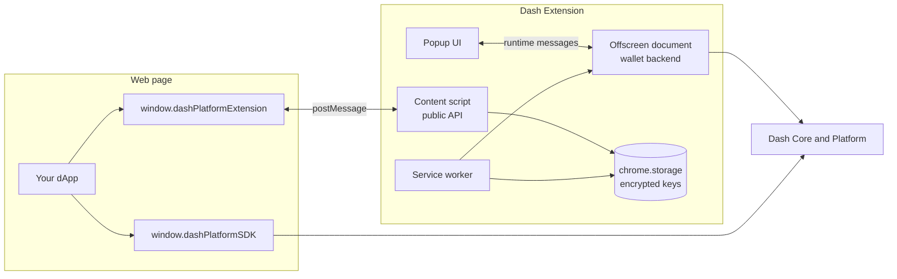

<p align="center">
  
</p>

<h1 align="center">Dash Extension</h1>

<p align="center">
  <b>A self-custody browser wallet for Dash Core and Dash Platform,<br>and the signer your dApp connects to.</b>
</p>

<p align="center">
  <a href="https://github.com/pshenmic/dash-platform-extension/releases/latest"></a>
  <a href="https://github.com/pshenmic/dash-platform-extension/actions/workflows/build.yml"></a>
  
  
</p>

<p align="center">
  <a href="#install">Install</a> ·
  <a href="#integrate-it-into-your-dapp">Integrate</a> ·
  <a href="docs/INTEGRATION.md">Integration guide</a> ·
  <a href="API.md">API reference</a> ·
  <a href="#for-ai-agents">For AI agents</a>
</p>

---

## Why Dash Extension

**For users:** hold your Dash, identities and tokens in your browser, and use Dash dApps without handing your keys to a website.

**For developers:** add wallet connection and transaction signing with two calls, in the MetaMask-style flow users already know.

## Features

| | |
|---|---|
| 🔑 **Self-custody** | Create or import seed phrase wallets. Keys are stored encrypted, and you enter your password to sign. |
| 🪙 **Core and Platform** | Separate dashboards for Layer 1 and Platform, with one total balance. |
| 🪪 **Identities** | Register, top up and import identities, including masternode identities. Manage public keys and register usernames. |
| 💸 **Transfers** | Move funds between Core, Platform addresses, identities and the shielded pool. Send credits and tokens. |
| 🛡️ **Shielded transfers** | Keep balances and payments private with the shielded pool. |
| 🌐 **dApp permissions** | Each website has to ask to connect, and only sees the identities you grant. |
| 🔍 **Readable approvals** | See the decoded transaction, including its type, contract and data, before you sign. |
| 🧪 **Mainnet and testnet** | Switch networks and keep several wallets. |

## Screenshots

<table>
  <tr>
    <td align="center"><br><sub><b>Total balance</b></sub></td>
    <td align="center"><br><sub><b>Platform dashboard</b></sub></td>
    <td align="center"><br><sub><b>Transaction history</b></sub></td>
  </tr>
  <tr>
    <td align="center"><br><sub><b>Send between layers</b></sub></td>
    <td align="center"><br><sub><b>Website permissions</b></sub></td>
    <td align="center"><br><sub><b>Decoded approvals</b></sub></td>
  </tr>
</table>

<sub>Screenshots are from the development version (1.5.0) on testnet, so the latest release can differ slightly.</sub>

## Install

1. Download the zip for the [latest release](https://github.com/pshenmic/dash-platform-extension/releases/latest) and unzip it.
2. Open `chrome://extensions` in Chrome.
3. Turn on **Developer mode** in the top right.
4. Click **Load unpacked** and select the unzipped folder.
5. Pin Dash Extension to your toolbar, then open it and set a password.

> [!WARNING]
> Write down your seed phrase and keep it offline. The password can't be recovered, and your seed phrase is the only backup of your wallet.

## Integrate it into your dApp

The extension adds `window.dashPlatformExtension` to web pages. Connect, build a transaction with the SDK, and let the extension do the rest.

```js
// 1. Ask the user to connect. Call this from a click handler.
const { signer } = window.dashPlatformExtension
const { currentIdentity } = await signer.connect()

// 2. Build a transaction with the SDK, which is injected once the site is approved.
const sdk = window.dashPlatformSDK
sdk.setNetwork('testnet')

const contractId = '9jf2T5mLuoEXN2r24w9Kd5MNtJUnoMoB7YtFQNRznem3'
const nonce = await sdk.identities.getIdentityContractNonce(currentIdentity, contractId)
const identityContractNonce = nonce + 1n

const document = sdk.documents.create(contractId, 'note', { message: 'Hello, Dash!' }, currentIdentity, identityContractNonce)
const transition = sdk.documents.createStateTransition(document, 'create', { identityContractNonce })

// 3. The user approves, then the extension signs, broadcasts and waits for confirmation.
const signed = await signer.signAndBroadcast(transition.hex())
console.log('Transaction hash:', signed.hash(false))
```

This shows the shape of the flow. For production, also wait for both globals to appear and handle rejections. The [integration guide](docs/INTEGRATION.md) has a complete version you can copy, plus recipes, error handling and TypeScript types.

### Common mistakes

| Do this | Not this | Why |
|---|---|---|
| Wait for `window.dashPlatformExtension` | Check it once at startup | It's injected shortly after the page starts |
| Wait for `window.dashPlatformSDK` after `connect()` | Use it the moment `connect()` resolves | On a first connection it arrives a moment later |
| Call `sdk.setNetwork(...)` | Assume it matches the wallet | The injected SDK always starts on mainnet |
| Pass `transition.hex()` | Pass the transition object | The object fails with `Unrecognized state transition type` |
| Use `currentIdentity` or `identities[i].identifier` | Treat `identities` as strings | Each entry is an object |
| Declare UTF-8 and allow `'wasm-unsafe-eval'` in your CSP | Leave either one out | Otherwise the extension silently doesn't load on the page |

## For AI agents

If you're a coding agent adding Dash Extension to a project, follow these rules. They reflect how the extension behaves today, and they override older examples you may find.

**Read first:** [`docs/INTEGRATION.md`](https://raw.githubusercontent.com/pshenmic/dash-platform-extension/master/docs/INTEGRATION.md) for the flow and [`API.md`](https://raw.githubusercontent.com/pshenmic/dash-platform-extension/master/API.md) for exact signatures and errors.

**Do:**

1. Poll for `window.dashPlatformExtension` for about 5 seconds before deciding it isn't installed.
2. Call `signer.connect()` from a user action, then poll for `window.dashPlatformSDK`.
3. Call `sdk.setNetwork('mainnet' | 'testnet')` before any query.
4. Use the nonce plus one: `getIdentityContractNonce` for documents and tokens, `getIdentityNonce` for identity-level transitions.
5. Pass `transition.hex()` to `signer.signAndBroadcast()`.
6. Read errors as `error?.message ?? String(error)`, since some rejections are plain strings.
7. Handle the no-extension, user-rejected, no-identity (`currentIdentity === null`) and 3-minute-timeout cases in the UI.
8. Make sure the page declares UTF-8, and add `'wasm-unsafe-eval'` to `script-src` if it has a CSP.

**Don't:**

- Don't ask for, store or handle private keys, seed phrases or the wallet password. The extension handles them.
- Don't pass a `StateTransitionWASM` object to the signer.
- Don't call `waitForStateTransitionResult` after `signAndBroadcast`. It has already waited.
- Don't call `dashPlatformExtension.connect()`. The method is on `dashPlatformExtension.signer`.
- Don't use mainnet for testing unless the user asks you to.

**Check your work:** you can't approve the popups for the user, so ask them to test the connect and sign flows on testnet using the [checklist](docs/INTEGRATION.md#test-your-integration).

## Security

- **Encrypted at rest.** Seed phrases and private keys are encrypted with your password before they're saved to browser storage.
- **Password to sign.** Every signature needs your password, and the wallet locks after 15 minutes of inactivity and when the browser closes.
- **Keys stay in the extension.** Websites receive signed transactions, never keys.
- **Permissions per site.** Approvals apply to one origin, on one network, in one wallet. The extension takes the origin from the browser, so a page can't claim to be another site.
- **The SDK only loads when needed.** Only the signer is added to every page. The SDK is injected only on sites you've approved.

Only connect to websites you trust, and check the decoded details before you sign.

## Architecture



## Build from source

You need **Node.js 22 or 24** and Yarn 1.

```bash
git clone https://github.com/pshenmic/dash-platform-extension.git
cd dash-platform-extension
yarn
yarn build
```

Then load the `dist` folder through **Load unpacked** at `chrome://extensions`.

| Command | What it does |
|---|---|
| `yarn build` | Production build of the whole extension into `dist` |
| `yarn serve` | Development server for the UI only |
| `yarn test` | Run the tests with Jest |
| `yarn lint` | Run `ts-standard` and fix what it can |

Open pull requests against the `develop` branch.

## Versions

| Version | Highlights |
|---|---|
| **1.6.x** (in progress) | Dash Platform v5.0 support |
| **1.5.x** | Dash Core chain support, new per-wallet, Core and Platform dashboards, major UX rework |
| **1.4.x** | Platform addresses, shielded transfers |
| **1.3.x** | Identity registration, withdrawals to Dash Core |
| **1.2.x** | Identity public key management, private key export, details on the approval screen |
| **1.1.x** | Masternode identities, credit and token transfers |
| **1.0.x** | Mainnet, DashPay seed phrases, multiple wallets and identities, tokens on the home screen |
| **0.0.x** | Proof of concept on testnet, web integration and SDK |

See the [releases](https://github.com/pshenmic/dash-platform-extension/releases) for full notes.

## Related projects

- [dash-platform-sdk](https://github.com/pshenmic/dash-platform-sdk): the JavaScript SDK for Dash Platform
- [Platform Explorer](https://github.com/pshenmic/platform-explorer): the block explorer for Dash Platform
- [dash-ui-kit](https://github.com/AlexeyTripleA/dash-ui-kit): the UI components used by this extension
