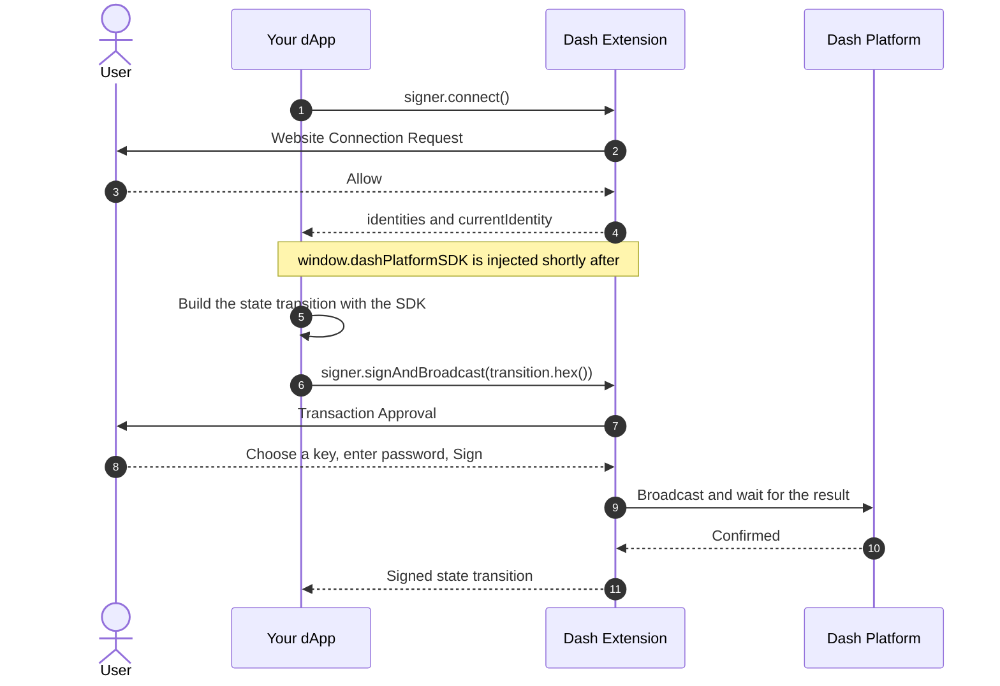

# Integrating Dash Extension into your dApp

Dash Extension holds the user's keys. Your website builds a transaction, the extension shows it to the user, and after the user approves it the extension signs it, broadcasts it and waits for the network to confirm it. Your code never sees a private key or the password.

- [How it works](#how-it-works)
- [Quickstart](#quickstart)
- [Step by step](#step-by-step)
- [Choosing a network](#choosing-a-network)
- [Handling errors](#handling-errors)
- [Page requirements](#page-requirements)
- [Recipes](#recipes)
- [TypeScript](#typescript)
- [Test your integration](#test-your-integration)
- [Using your own SDK](#using-your-own-sdk)

## How it works



Two globals are involved:

| Global | Available | What it is |
|---|---|---|
| `window.dashPlatformExtension` | Shortly after page load, on every `http(s)` page | The signer: `connect()` and `signAndBroadcast()` |
| `window.dashPlatformSDK` | After the site is approved | A [Dash Platform SDK](https://github.com/pshenmic/dash-platform-sdk) instance for queries and for building transitions |

## Quickstart

A complete example that publishes a `note` document on testnet. It's a plain script with no build step. Call `publishNote` from a click handler so that the browser allows the popups.

```js
// Set this to the network your dApp and its data contract live on
const NETWORK = 'testnet'
const DATA_CONTRACT_ID = '9jf2T5mLuoEXN2r24w9Kd5MNtJUnoMoB7YtFQNRznem3'

// Neither global exists at the moment your script starts, so wait for them
async function waitFor (getValue, timeoutMs) {
  const deadline = Date.now() + timeoutMs

  while (getValue() == null) {
    if (Date.now() > deadline) return null
    await new Promise(resolve => setTimeout(resolve, 50))
  }

  return getValue()
}

async function connectWallet () {
  const extension = await waitFor(() => window.dashPlatformExtension, 5000)

  if (extension == null) {
    throw new Error('Dash Extension is not installed or is blocked on this page')
  }

  const { currentIdentity, identities } = await extension.signer.connect()

  if (currentIdentity == null) {
    throw new Error('This wallet has no identities yet')
  }

  const sdk = await waitFor(() => window.dashPlatformSDK, 10000)

  if (sdk == null) {
    throw new Error('Dash Platform SDK was not injected')
  }

  // The injected SDK always starts on mainnet
  sdk.setNetwork(NETWORK)

  return { signer: extension.signer, sdk, currentIdentity, identities }
}

async function publishNote (message) {
  const { signer, sdk, currentIdentity } = await connectWallet()

  const nonce = await sdk.identities.getIdentityContractNonce(currentIdentity, DATA_CONTRACT_ID)
  const identityContractNonce = nonce + 1n

  const document = sdk.documents.create(DATA_CONTRACT_ID, 'note', { message }, currentIdentity, identityContractNonce)
  const transition = sdk.documents.createStateTransition(document, 'create', { identityContractNonce })

  // Pass hex, not the object. See "Sign and broadcast" below.
  // Resolves once the network has confirmed the transaction.
  const signed = await signer.signAndBroadcast(transition.hex())

  return signed.hash(false)
}
```

## Step by step

### 1. Detect the extension

`window.dashPlatformExtension` appears a moment after the page starts, because the extension injects it asynchronously. Checking once at startup gives a false "not installed", so poll for a few seconds as `waitFor` does above.

If it never appears, either the extension isn't installed or the page doesn't meet the [page requirements](#page-requirements).

### 2. Connect

```js
const { currentIdentity, identities } = await window.dashPlatformExtension.signer.connect()
```

- **First call for a site:** opens the Website Connection Request popup and waits for the user. It rejects if the user clicks Reject or closes the popup.
- **Already approved:** resolves straight away with no popup, so it's safe to call on every page load if you want to restore a session. For a site the user hasn't approved yet, that same call opens a popup, so keep the first call behind a button.
- **Scope of an approval:** it covers one origin on one network in one wallet. If the user switches wallet or network, your site asks again.

The result looks like this:

```js
{
  currentIdentity: 'Aa1ZUSjKsQDNJTV53NYs7PtaxKjCxdegZrqeywFy5y4M', // null if no identity is available
  identities: [
    { identifier: 'Aa1ZUSjKsQDNJTV53NYs7PtaxKjCxdegZrqeywFy5y4M', type: 'regular', proTxHash: null }
  ]
}
```

`type` is `regular`, `masternode` or `voting`. `identities` holds the identity objects, not plain ID strings. Approving grants the site the identities the wallet holds at that moment.

### 3. Wait for the SDK

On a first-time connection, `window.dashPlatformSDK` is still `undefined` when `connect()` resolves, and arrives a moment later. On later visits to an approved site it's injected on page load. Wait for it either way, as the quickstart does.

### 4. Build a state transition

Fetch the current nonce, add one, and build the transition with the SDK. The method depends on what you're doing. See [Recipes](#recipes) and the [SDK documentation](https://pshenmic.github.io/dash-platform-sdk/index.html).

### 5. Sign and broadcast

```js
const signed = await window.dashPlatformExtension.signer.signAndBroadcast(transition.hex())
console.log('Transaction hash:', signed.hash(false))
```

> [!IMPORTANT]
> Don't pass a `StateTransitionWASM` from `window.dashPlatformSDK` directly. The SDK and the signer are separate bundles, so the signer's `instanceof` check fails with `Unrecognized state transition type`. Pass `transition.hex()`, `transition.base64()` or `transition.bytes()`.

The extension opens the Transaction Approval popup, where the user reviews the decoded transaction, chooses a signing key and enters their password. The promise settles as follows:

- **Resolves** with the signed state transition after it has been broadcast and the network has returned its result. You don't need to call `waitForStateTransitionResult` yourself.
- **Rejects** if the user cancels, if broadcasting fails, or after 3 minutes without a decision.

The site may only submit transitions owned by an identity it was granted. Sites can't submit identity creation transitions.

## Choosing a network

The injected SDK always starts on mainnet, whichever network the wallet is on, so a dApp should call `sdk.setNetwork(...)` every time.

`connect()` doesn't currently tell you the wallet's network. If your dApp supports both networks, you can read it from the same underlying call that `connect()` uses:

```js
const { signer } = window.dashPlatformExtension
const { network } = await signer.publicAPIClient.connectApp(window.location.origin)

window.dashPlatformSDK.setNetwork(network)
```

> [!NOTE]
> `publicAPIClient` is an internal field, not part of the public API, and it may change. Call it only after `connect()` has resolved, since `network` is `null` until the site is approved.

## Handling errors

Most failures reject with an `Error`, but failures from the extension's message layer reject with a **plain string**. Always read the message defensively:

```js
try {
  await publishNote('Hello')
} catch (error) {
  const message = error?.message ?? String(error)
  console.error(message)
}
```

| Message | Meaning | What to do |
|---|---|---|
| `App connection was rejected` | The user clicked Reject or closed the connection popup | Let the user try again |
| `Transaction signing was rejected` | The user cancelled the approval | Let the user try again |
| `Internal error during singing the transaction` | Signing or broadcasting failed after approval. The spelling is what the extension currently returns, so don't match on it. | Rebuild with a fresh nonce and try again |
| `Application on url <origin> is not authorized` | The site isn't approved yet (string) | Call `connect()` first |
| `No wallet loaded in the extension` | The user has no wallet yet (string) | Ask them to create or import one |
| `State transition owner <id> is not granted to this application` | The transition's owner isn't one of the granted identities (string) | Use an identity returned by `connect()` |
| `Failed to receive state transition signing approval due timeout` | 3 minutes passed with no decision, or the popup was blocked or closed | Let the user try again |
| `Timed out waiting for response of <method>` | The extension didn't answer (string) | Ask the user to reload the page |

> [!NOTE]
> Closing the Transaction Approval popup doesn't reject the promise. It stays pending until the 3-minute timeout, so don't lock your UI on it.

## Page requirements

The extension fails silently when a page doesn't meet these, so check them first if `window.dashPlatformExtension` never appears.

| Requirement | Why |
|---|---|
| Declare UTF-8 with `<meta charset="utf-8">` or the `Content-Type` header | Otherwise the injected bundle is misread and fails with `invalid block type` in the console |
| Allow `'wasm-unsafe-eval'` in `script-src` if the page has a Content Security Policy | Otherwise WebAssembly is blocked and the extension doesn't load on the page |
| Run in the top-level window | The extension isn't injected into iframes |
| Serve over `http` or `https` | Connections from other protocols, such as `file://`, are refused |
| Call `connect()` and `signAndBroadcast()` from a user action, such as a click | Browsers can block popups that don't follow a user action |

The injected bundles are large, more than 4 MB each, so give them a moment on slow machines. You may also see `SharedArrayBuffer transfer requires self.crossOriginIsolated` in the console on approved sites. It didn't stop any of the flows in this guide.

## Recipes

Each recipe assumes you've already called `connectWallet()` from the quickstart.

### Replace or delete a document

Fetch the existing document, then build the transition. Use `'replace'` or `'delete'` as the type:

```js
const [existing] = await sdk.documents.query(DATA_CONTRACT_ID, 'note', [['$id', '==', documentId]])
const nonce = await sdk.identities.getIdentityContractNonce(currentIdentity, DATA_CONTRACT_ID)

const transition = sdk.documents.createStateTransition(existing, 'delete', {
  identityContractNonce: nonce + 1n
})

await signer.signAndBroadcast(transition.hex())
```

### Transfer credits between identities

Identity-level transitions use the identity nonce rather than the contract nonce. 1 Dash is 100,000,000,000 credits.

```js
const nonce = await sdk.identities.getIdentityNonce(currentIdentity)

const transition = sdk.identities.createStateTransition('creditTransfer', {
  identityId: currentIdentity,
  recipientId,
  amount: 100000000n,
  identityNonce: nonce + 1n
})

await signer.signAndBroadcast(transition.hex())
```

### Read data

Queries need no signature or popup, only the SDK:

```js
const balance = await sdk.identities.getIdentityBalance(currentIdentity)
const notes = await sdk.documents.query(DATA_CONTRACT_ID, 'note')
```

The SDK repository has [examples](https://github.com/pshenmic/dash-platform-sdk/tree/master/docs/examples) for tokens, names, data contracts, voting and platform addresses.

## TypeScript

The extension doesn't publish a types package yet. Add these declarations to your project:

```ts
import type { DashPlatformSDK, StateTransitionWASM } from 'dash-platform-sdk'

interface IdentityInfo {
  identifier: string
  type: 'regular' | 'masternode' | 'voting'
  proTxHash: string | null
}

interface WalletInfo {
  identities: IdentityInfo[]
  currentIdentity: string | null
}

interface ExtensionSigner {
  connect: () => Promise<WalletInfo>
  signAndBroadcast: (stateTransition: string | Uint8Array) => Promise<StateTransitionWASM>
}

declare global {
  interface Window {
    dashPlatformExtension?: { signer: ExtensionSigner }
    dashPlatformSDK?: DashPlatformSDK
  }
}
```

## Test your integration

1. Install the extension and switch its network to **Testnet**.
2. Create or import a wallet with a funded testnet identity.
3. Run your dApp locally. `http://localhost` works.
4. Go through these cases:
   - Connect and approve, then reload the page. There should be no second popup.
   - Connect and reject. Your UI should recover.
   - Sign and approve, then look the hash up on [Platform Explorer](https://testnet.platform-explorer.com).
   - Sign and cancel. Your UI should recover.
   - Open the page without the extension installed. Your UI should offer an install link.

## Using your own SDK

You don't have to use the injected SDK. Install it from npm and build transitions with your own instance, which also gives you your own version and types:

```bash
npm install dash-platform-sdk
```

```js
import { DashPlatformSDK } from 'dash-platform-sdk'

const sdk = new DashPlatformSDK({ network: 'testnet' })
```

Your instance still has its own WebAssembly classes, so pass `transition.hex()` to the signer here too.

For the underlying message protocol, see [API.md](../API.md).
